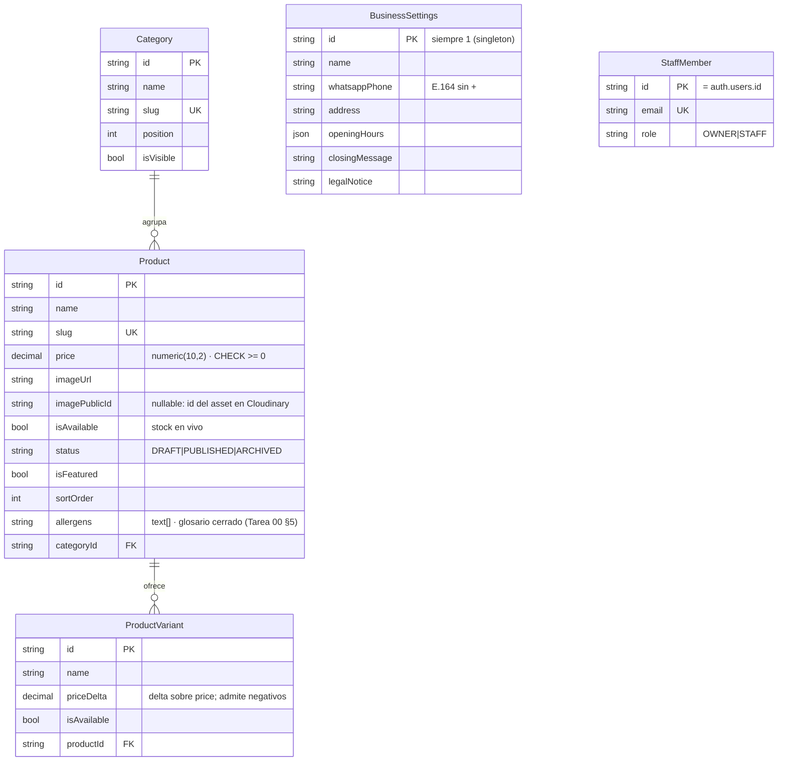

# Modelo de datos — Mi Negocio

> Espejo de `prisma/schema.prisma` (Tarea 03). Si este diagrama y el schema
> divergen, gana el schema y se corrige este documento en el mismo commit.

**Reglas de lectura del modelo:**

- El catálogo público lee **únicamente** `status = 'PUBLISHED'`.
- `isAvailable` filtra la capa de disponibilidad, no la de publicación.
- No existe `Order`: el pedido se materializa en el WhatsApp del local.
- **`ProductVariant` está sin uso en v1** (decisión D-02, Tarea 00): ningún
  repositorio ni UI lo consume. Se conserva en el modelado porque D-02 lo
  permite como vía de retrofit sin migración destructiva; agregar variantes
  reales exige reabrir esa decisión de negocio.
- `products.price` lleva `CHECK (price >= 0)` a nivel base
  (`products_price_non_negative`); `.priceDelta` admite negativos a propósito
  (un descuento por variante).
- `Category.products` usa `onDelete: Restrict` (no se borra una categoría con
  productos asignados); `ProductVariant.product` usa `onDelete: Cascade`
  (borrar el producto borra sus variantes).
- `StaffMember` replica `auth.users.id` y **no** almacena credenciales: eso
  es de Supabase Auth. Esta tabla solo autoriza.
