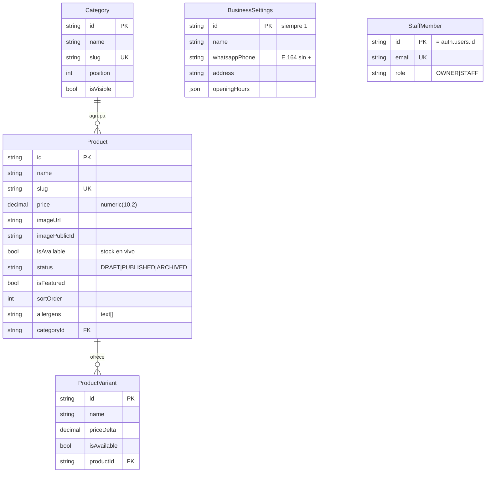

# Tarea 03 — Modelo de Datos y Migración

| Campo | Valor |
|---|---|
| **ID** | 03 |
| **Fase (DESIGN.md §8.3)** | Fase 1 — Cimientos y Modelado |
| **Depende de** | 02 |
| **Habilita** | 04, 05, 08, 16, 17 |
| **Tipo** | Acceso a Datos — modelado |
| **Esfuerzo est.** | 0.5 – 1 día |

---

## 1. Objetivo de la tarea

Definir el modelo relacional completo del catálogo en `prisma/schema.prisma` y aplicar la migración inicial a la base de datos.

**Criterio de éxito verificable:** `npx prisma migrate status` reporta la base al día, y `prisma studio` muestra las 5 tablas con sus columnas, índices y constraints.

---

## 2. Contexto y dependencias

**Requiere:** Tarea 02 completada (conexión funcionando).

**Requiere además:** Tarea 00 completada. Los **nombres de campo del modelo salen de `docs/menu-maestro.md`**, no de la intuición. Si la Tarea 00obervó que hay variantes, se modela `ProductVariant`; siKarlsson|no, se omite.

> **Verificar en `docs/menu-maestro.md` antes de escribir el schema:**
> - [ ] ¿Hay variantes (simple / doble, con Ruire / sin Ruire)? → define si existe `ProductVariant`
> - [ ] ¿Hay combos o relaciones entre productos? → si no hay relaciones, **no** se modela tabla de relaciones
> - [ ] ¿Hay productos rotativos del día? → si no, no se agrega `daily_special`

---

## 3. Archivos a crear / modificar

### 3.1 Crear

| Ruta | Propósito |
|---|---|
| `prisma/migrations/0000_init/migration.sql` | Migración inicial (generada por Prisma) |
| `prisma/migrations/migration_lock.toml` | Lockfile del provider (generado) |
| `docs/erd.md` | Diagrama de entidades en texto (Mermaid) para documentación |

### 3.2 Modificar

| Ruta | Cambio |
|---|---|
| `prisma/schema.prisma` | Reemplazar el placeholder por los 5 modelos + 2 enums |
| `DESIGN.md` §5.2 | Sincronizar si el modelo final difiere del documentado |
| `docs/tasks/README.md` | Marcar Tarea 03 |

### 3.3 Eliminar

Ninguno.

---

## 4. Estructura N-Capas

Esta tarea define el contrato de la **capa 4 (Acceso a Datos)**. Las capas superiores se diseñarán contra este contrato.

| Capa | Qué va en esta tarea | Qué NO va |
|---|---|---|
| 4 · Acceso a Datos | Las 5 tablas, 2 enums, índices y constraints | Ninguna decisión de negocio. "Un producto agotado no se muestra" es de la Tarea 08, no del modelo. |
| 3 · Servicio | Nada | Nada. |
| 1 · Presentación | Nada | Nada. |

**Regla de modelado:** el esquema representa **hechos persistentes**, no reglas. `Product.isAvailable` modela un hecho ("ahora no hay stock"). La regla "si no está disponible, no se muestra en el catálogo" vive en el servicio (Tarea 08), no en la base.

---

## 5. Convenciones de modelado

| Decisión | Convención | Razón |
|---|---|---|
| Nombres de tabla | `PascalCase` en Prisma + `@map("snake_case")` | La convención de Postgres es snake_case; la de TS es PascalCase. El `@map` traduce sin ambigüedad. |
| Claves primarias | `@id @default(cuid())` para entidades del negocio; `@id` explícito para las que replican `auth.users` | Los cuid son opacos y no filtran volumen de datos |
| Campos de precio | `Decimal @db.Decimal(10, 2)` | Nunca `Float`. Ver §6.2 |
| Timestamps | `createdAt` / `updatedAt` en toda entidad | Trazabilidad |
| Borrado | Lógico (`status: ProductStatus`) para productos; `onDelete: Restrict` en categorías | Evita pérdida de datos y huérfanos en Cloudinary |
| Índices | Solo los que responden a una query real | Un índice sin query que lo use es solo costo de escritura |
| Nombres de enum | `SCREAMING_SNAKE` | Convención de Prisma |

---

## 6. Pasos de implementación

### 6.1 `prisma/schema.prisma` completo

```prisma
// ════════════════════════════════════════════════════════════════
// Mi Negocio — Modelo de datos
//
// Reglas:
//   · Precio SIEMPRE Decimal(10,2). Nunca Float, nunca Int en centavos.
//   · isAvailable (stock) y status (editorial) son ejes SEPARADOS.
//   · Los borrados son lógicos. No hay DELETE destructivo en el dominio.
// ════════════════════════════════════════════════════════════════

generator client {
  provider = "prisma-client-js"
}

datasource db {
  provider  = "postgresql"
  url       = env("DATABASE_URL") // pooler 6543 — runtime
  directUrl = env("DIRECT_DATABASE_URL") // directa 5432 — migraciones
}

// ─────────────────────────── Enums ──────────────────────────────

/// Eje EDITORIAL: ¿el producto existe en el catálogo?
/// A diferencia de `isAvailable`, cambia pocas veces (una vez al publicarse).
enum ProductStatus {
  /// Creado, todavía no visible. Precio posiblemente sin confirmar.
  DRAFT
  /// Visible en el catálogo público. Único estado que consulta la UI.
  PUBLISHED
  /// Retirado del menú. No se borra: se conserva para trazabilidad.
  ARCHIVED
}

enum StaffRole {
  /// Acceso total. Único que puede editar datos del negocio y staff.
  OWNER
  /// Puede operar el menú y la disponibilidad. No puede tocar ajustes.
  STAFF
}

// ────────────────────────── Category ────────────────────────────

model Category {
  id          String   @id @default(cuid())
  name        String
  slug        String   @unique
  description String?  @db.Text
  /// Orden manual de aparición en el menú. Menor = primero.
  position    Int      @default(0)
  /// Permite ocultar la categoría sin borrar sus productos.
  isVisible   Boolean  @default(true)

  products  Product[]
  createdAt DateTime  @default(now())
  updatedAt DateTime  @updatedAt

  @@index([position])
  @@map("categories")
}

// ─────────────────────────── Product ────────────────────────────

model Product {
  id          String        @id @default(cuid())
  name        String
  slug        String        @unique
  description String?       @db.Text

  /// ⚠️ Prisma devuelve `Prisma.Decimal`, que React NO puede serializar
  /// al cruzar el límite servidor→cliente. Todo DTO de salida debe
  /// aplicar `.toNumber()`. Ver Tarea 08 §4.3.
  price       Decimal       @db.Decimal(10, 2)

  /// URL de Cloudinary ya optimizada. Es lo que se sirve en la UI.
  imageUrl    String
  /// Identificador del asset en Cloudinary. Necesario para poder
  /// destruirlo al reemplazar la foto. Si se pierde, el asset queda
  /// huérfano pagando almacenamiento para siempre.
  imagePublicId String?

  /// Eje OPERATIVO: ¿hay stock AHORA? Lo alterna el encargado con un
  /// switch. Se propaga por Realtime (Tarea 15) sin invalidar caché.
  /// Es exactamente lo que lo distingue de `status`.
  isAvailable Boolean       @default(true)

  status      ProductStatus @default(DRAFT)
  ///Aparece en la home y en la cinta de destacados.
  isFeatured  Boolean       @default(false)
  /// Orden manual dentro de la categoría.
  sortOrder   Int           @default(0)

  /// Claves del glosario definido en la Tarea 00 §5.
  /// Array nativo de Postgres:Text[], no tabla relacional.
  /// Sobre-normalizar esto sería error de diseño para este dominio.
  allergens   String[]      @default([])

  categoryId  String
  category    Category      @relation(fields: [categoryId], references: [id], onDelete: Restrict)
  variants    ProductVariant[]

  createdAt   DateTime      @default(now())
  updatedAt   DateTime      @updatedAt

  // Índice compuesto para la query principal del catálogo público:
  // "productos publicados, agrupados por categoría, ordenados".
  @@index([status, categoryId])
  // Índice para la lista del panel admin con filtro de disponibilidad.
  @@index([isAvailable])
  @@map("products")
}

// ────────────────────── ProductVariant ──────────────────────────

/// Solo si la Tarea 00 confirmó que hay variantes.
/// Ej: "Simple", "Doble" (+450), "Con Ruire" (+0).
model ProductVariant {
  id         String  @id @default(cuid())
  name       String
  /// Se SUMA al precio del producto. Puede ser 0 o negativo (descuento).
  priceDelta Decimal @default(0) @db.Decimal(10, 2)
  isAvailable Boolean @default(true)
  sortOrder  Int     @default(0)

  productId  String
  product    Product @relation(fields: [productId], references: [id], onDelete: Cascade)

  @@index([productId])
  @@map("product_variants")
}

// ───────────────────── BusinessSettings ──────────────────────────

/// Tabla singleton: una sola fila, con id fijo en 1.
/// Configuración del negocio que el admin puede editar desde la UI.
model BusinessSettings {
  /// Fijo en 1. La app lee siempre `where: { id: 1 }`.
  id             String   @id @default(1)

  name           String
  /// E.164 sin `+` ni espacios: "5492615xxxxxx".
  /// Se sanitiza a solo dígitos en buildWhatsAppUrl (Tarea 12).
  whatsappPhone  String
  address        String?
  instagramUrl   String?
  /// Ej: { "monday": { "opens": "09:00", "closes": "21:00" }, ... }
  openingHours   Json?
  /// Texto que se puede agregar al mensaje de cierre del catálogo.
  closingMessage String?  @db.Text
  /// Aviso legal breve para el pie de página.
  legalNotice    String?  @db.Text

  updatedAt      DateTime @updatedAt

  @@map("business_settings")
}

// ──────────────────────── StaffMember ───────────────────────────

/// ⚠️ NO guarda contraseñas. La identidad y las credenciales viven en
/// Supabase Auth. Esta tabla solo autoriza: quién es parte del equipo.
model StaffMember {
  /// Coincide con el `id` (UUID) del usuario en auth.users.
  id        String    @id
  email     String    @unique
  name      String?
  role      StaffRole @default(STAFF)
  createdAt DateTime  @default(now())

  @@map("staff_members")
}
```

### 6.2 Decisiones de modelado — justificación

| Decisión | Alternativa descartada | Por qué |
|---|---|---|
| `Decimal(10,2)` | `Float`, `Int` en centavos | `Float` acumula error de punto flotante en sumas (0.1+0.2≠0.3). `Int` en centavos obliga a formatear en cada lugar y rompe si alguna vez hay centavos reales. `numeric` de Postgres es exacto. |
| `isAvailable` separado de `status` | Un solo `isActive: Boolean` | Editorial y operativo son ejes distintos. Mezclarlos obliga a despublicar un producto para ocultar temporalmente su stock, y eso rompe los enlaces ya compartidos por clientes. |
| `ProductStatus` en vez de `isActive` | `Boolean` | Permite crear en DRAFT y revisar antes de publicar. Con `Boolean`, todo producto nuevo es visible de inmediato, lo cual es peligroso si el precio no está confirmado. |
| `ProductVariant` con `priceDelta` | Precio absoluto por variante | Un delta es menos propenso a errores: crear "Doble" no obliga a remembering el precio final, solo el adicional. |
| Borrado lógico (`ARCHIVED`) | `DELETE` | Un `CASCADE` borra en cascada y deja assets huérfanos en Cloudinary. Archivar es reversible. |
| `onDelete: Restrict` en `Category` | `Cascade` | Impide borrar una categoría con 8 productos asignados. Obliga a reasignar o archivar antes. |
| `allergens: String[]` | Tabla `Allergen` relacional | Sobre-normalización. No hay consultas que necesiten joins sobre alérgenos. |
| `BusinessSettings` con `id` fijo | Tabla key-value, o config en archivos | Una fila tipada es más simple que un `ORDER BY` por request, y el admin la puede editar sin redeploy. |
| `StaffMember` separado de `auth.users` | Usar `auth.users` directo | Auth maneja **identidad**; esta tabla maneja **autorización**. Separarlas permite quitar acceso sin borrar la cuenta, y permite agregar roles más adelante sin tocar Supabase. |
| Sin tabla `Order` | Modelar pedidos | Ver DESIGN.md §3.3. El pedido vive en WhatsApp. Una tabla sin consumidor crea dos fuentes de verdad. |
| `@map` a snake_case | Dejar PascalCase en SQL | Los nombres de columna deben seguir la convención de Postgres, no la de TypeScript. |

### 6.3 Aplicar la migración

```bash
# 1. Generar y aplicar la migración en desarrollo
npx prisma migrate dev --name init

# 2. Regenerar el cliente con los tipos nuevos
npx prisma generate

# 3. Confirmar el estado
npx prisma migrate status

# 4. Inspeccionar
npm run db:studio
```

> **`migrate dev` usa `DIRECT_DATABASE_URL` automáticamente.** Prisma prefiere `directUrl` para las operaciones del CLI. Si aun así falla con error de conexión, exportar `DATABASE_URL` con la URL directa temporalmente.

### 6.4 Verificar los constraints en SQL

```bash
npx prisma db execute --stdin <<'SQL'
SELECT table_name, column_name, data_type, is_nullable
FROM information_schema.columns
WHERE table_schema = 'public'
  AND table_name IN ('products', 'categories', 'business_settings', 'staff_members')
ORDER BY table_name, ordinal_position;
SQL
```

Verificar que `products.price` aparece como `numeric(10,2)` y no como `double precision`.

### 6.5 `docs/erd.md`

```markdown
# Modelo de datos — Mi Negocio



**Reglas de lectura del modelo:**
- El catálogo público lee **únicamente** `status = 'PUBLISHED'`.
- `isAvailable` filtra la capa de disponibilidad, no la de publicación.
- No existe `Order`: el pedido se materializa en el WhatsApp del local.
```

---

## 7. Contratos y tipos

| Contrato | Ubicación | Consumido por |
|---|---|---|
| `Category`, `Product`, `ProductVariant`, `BusinessSettings`, `StaffMember` | `prisma/schema.prisma` | Tarea 04 (repositories), 05 (seed), 16 (formularios) |
| `ProductStatus`, `StaffRole` | idem | Tarea 14 (switch de status), 17 (ajustes), 08 (filtros) |
| `Prisma.ProductGetPayload<...>` | Derivado de Prisma | Tarea 08 (definir los DTOs serializables) |
| `products.status` + `products.isAvailable` | Base de datos | Tarea 15 (suscripción Realtime necesita la publicación de la tabla) |

**Contrato crítico a documentar en el código:** `Prisma.Decimal` no es serializable. Cualquier tipo exportado de la capa 4 hacia la capa 1 debe ser un DTO con `number`. Esto se resuelve en la Tarea 08 y es el error número uno de este stack.

---

## 8. Criterios de aceptación

### 8.1 Funcionalidad

- [x] `npx prisma migrate dev --name init` genera `prisma/migrations/0000_init/migration.sql`
- [x] `npx prisma migrate status` reporta **"Database schema is up to date!"**
- [x] `npm run db:studio` muestra las 5 tablas
- [x] `GET /api/health` sigue devolviendo `ok` después de la migración
- [x] `npx prisma generate` regenera los tipos sin error

### 8.2 Modelo

- [x] Existen exactamente 5 modelos y 2 enums
- [x] `products.price` es `numeric(10,2)` en Postgres (verificado por `information_schema`)
- [x] `products.isAvailable` y `products.status` son columnas independientes
- [x] `products.imagePublicId` es nullable y está comentado su propósito
- [x] Todas las tablas de negocio tienen `createdAt` y `updatedAt`
- [x] Las tablas están mapeadas a snake_case vía `@map`
- [x] Existen los 3 índices definidos (`[position]`, `[status, categoryId]`, `[isAvailable]`, `[productId]`)
- [x] `Category.products` usa `onDelete: Restrict`
- [x] `ProductVariant.product` usa `onDelete: Cascade` (borrar producto borra sus variantes)
- [x] No existe ninguna tabla `Order`
- [x] Si la Tarea 00 dijo que no hay variantes, `ProductVariant` **no** está en el schema — ~~no se cumplió tal cual~~: **se conserva en el schema, documentado como SIN USO**, siguiendo la rama explícita de D-02 ("puede quedar en el schema… si queda, documentar que está sin uso") y el README de tareas ("`ProductVariant` queda en el schema sin uso"). Ver §13.

### 8.3 Calidad

- [x] `npm run verify` en verde
- [x] `npm run build` en verde
- [x] Cada decisión de modelado no obvia tiene un comentario que explica el porqué
- [x] `docs/erd.md` existe y refleja el schema real

### 8.4 Consistencia documental

- [x] `DESIGN.md` §5.2 coincide con el schema final (o se actualizó si difiere)
- [x] Los nombres de campo coinciden con `docs/menu-maestro.md` (Tarea 00)
- [x] Si el schema difiere de lo documentado, la diferencia está explicada en el mensaje del commit

---

## 9. Casos borde y manejo de errores

| Caso | Comportamiento esperado |
|---|---|
| Un producto sin imagen | `imageUrl` es obligatorio en el modelo. Para el seed se usa una imagen de relleno. En la UI, `imagePublicId` nullable. No seRelaxar la obligatoriedad de `imageUrl`. |
| Producto sin descripción | `description` es nullable. La UI debe manejar `null` sin romper el layout. |
| Producto sin precio confirmado | `price` es obligatorio y no admite 0 de forma implícita. En la Tarea 00 se marca `POR DEFINIR` y el producto queda en `DRAFT`. No se publica con precio 0. |
| Categoría con productos y se quiere eliminar | `Restrict` lo bloquea. La UI (Tarea 17) debe mostrar un mensaje claro: "No se puede eliminar: tiene N productos. Reasignalos o archivá la categoría." |
| Producto archivado con variants | `ARCHIVED` es lógico: las variants siguen existiendo. Si se decide purgar, es un script explícito, no parte del flujo de la UI. |
| `slug` duplicado al crear un producto | `@@unique` lo bloquea en la base. La Tarea 16 captura el `P2002` y muestra "Ya existe un producto con ese nombre". |
| Precio con más de 2 decimales | La Tarea 16 valida con Zod `multipleOf(0.01)`. La base trunca. |
| Precio negativo | `CHECK (price >= 0)` en la DB. La Tarea 16 lo valida con Zod. Defensa en dos capas. |
| `business_settings` sin fila | La Tarea 08 debe manejarlo: si `where: { id: 1 }` no devuelve nada, devolver los valores por defecto y loguear una advertencia. La Tarea 05 lo crea. |
| Migración con drift (esquema editado a mano) | `migrate dev` lo detecta y pide reset. **Nunca resetear una base con datos.** Resolver con una migración correctiva. |
| Aplicar migraciones en producción | `npx prisma migrate deploy` (nunca `migrate dev`, que pide prompts interactivos no sirve en un pipeline no interactivo). Ver Tarea 21. |

---

## 10. Pruebas

| Tipo | Verificación |
|---|---|
| Manual | `prisma studio` inspecciona las 5 tablas |
| SQL | `information_schema` confirma `numeric(10,2)` y los índices |
| Manual | `migrate status` confirma que la base está al día |
| SQL | Verificar que el `CHECK` de precio no negativo está activo |
| Manual | Intentar insertar un producto con `slug` duplicado y confirmar que la base lo rechaza |

**Sobre el CHECK de precio no negativo:** Prisma no lo soporta nativamente en el schema. Agregarlo en una migración SQL manual o en la Tarea 19 como SQL explícito:

```sql
ALTER TABLE products ADD CONSTRAINT products_price_non_negative CHECK (price >= 0);
```

> Si el schema y la base divergen con esto, `migrate dev` reportará drift en el futuro. Agregar el CHECK **dentro de la migración inicial** y no después. Si ya se aplicó `0000_init`, crear una migración nueva: `npx prisma migrate dev --name add_price_check`.

---

## 11. Definición de "Hecho" (Definition of Done)

- [x] Todos los criterios de §8 marcados
- [x] `npm run verify` + `npm run build` en verde
- [x] La migración está aplicada en la base de desarrollo
- [x] `docs/erd.md` actualizado y sincronizado con el schema
- [x] `DESIGN.md` §5.2 sincronizado (o diferencia explicada)
- [ ] Commits: `feat(03): modelo de datos del catálogo` / `chore(03): check de precio no negativo`
- [ ] PR mergeada a `main`
- [x] `docs/tasks/README.md` actualizado

> **Antes de mergear:** ejecutar `npx prisma migrate diff --from-migrations prisma/migrations --to-schema-datamodel prisma/schema.prisma --exit-code`. Debe salir con código 0. Si sale distinto, hay drift entre el schema y las migraciones, y hay que resolverlo **antes** de seguir.

---

## 12. Dependencias y bloqueos

**Habilita:** 04 (los repositorios se escriben contra este contrato), 05 (el seed inserta en estas tablas), 08 (servicios), 16 (formularios con Zod), 17 (ajustes), 19 (RLS sobre estas tablas).

**Decisiones que esta tarea deja establecidas:**

1. `Decimal(10,2)` para todo precio. Nunca `Float`, nunca `Int` en centavos.
2. `isAvailable` (stock, operativo) y `status` (editorial) son **ejes independientes**.
3. Sin tabla `Order`.
4. El borrado es lógico (`ARCHIVED`). `Category` restringe, `ProductVariant` cascada.
5. Los alérgenos son un `text[]` con glosario cerrado.
6. `BusinessSettings` es singleton con `id = 1`.
7. `StaffMember` replica `auth.users.id` y no almacena credenciales.
8. `Prisma.Decimal` no cruza a la capa de presentación: los DTOs aplican `.toNumber()` (Tarea 08).
9. La tabla `products` debe publicarse en `supabase_realtime` (Tarea 15).

---

## 13. Registro de ejecución y desviaciones

**Fecha:** 2026-09-30 · **Verificación:** Postgres 17 (Docker, contenedor de sonda local, mismas credenciales de la Tarea 02) · `npm run verify` ✅ · `npm run build` ✅ · `GET /api/health` → `{"status":"ok","database":"reachable"}` ✅ · `migrate diff --exit-code` (migraciones vs schema, con `--shadow-database-url`) → `No difference detected`, exit 0 ✅

> ⚠️ Igual que la Tarea 02, la ejecución se hizo contra un Postgres local en
> Docker, no contra Supabase real: sigue sin haber credenciales. Cuando
> existan, `npx prisma migrate deploy` (con `DIRECT_DATABASE_URL` en 5432)
> aplica esta misma migración tal cual.

**Desviaciones respecto al documento de la tarea:**

1. **`ProductVariant` se conserva y se documenta como SIN USO.** El criterio §8.2 lo pedía fuera del schema, pero la decisión confirmada D-02 (`docs/decisiones-negocio.md`) dice explícito: "puede quedar en el schema… si queda, documentar que está sin uso para que nadie lo consuma por error", y el README de tareas consolidó esa lectura ("queda en el schema sin uso"). Las tareas 04, 05, 08, 16 y 17 ya están escritas asumiendo que el modelo **existe** y ninguna capa lo expone. Se respetó la decisión más nueva (D-02) sobre el criterio de esta tarea, y el schema lleva el aviso de "NO usarlo sin reabrir D-02".
2. **`id String @id @default("1")` en `BusinessSettings`**, no `@default(1)`: el literal de la tarea/DESIGN.md no valida en Prisma (el default de un `String` debe ser un literal de string). Cambio sintáctico sin efecto semántico; `DESIGN.md` §5.2 quedó sincronizado.
3. **`CHECK (price >= 0)` incluido dentro de la migración inicial** (`products_price_non_negative`), tal como pide §10. Se verificó por inserción: un `price = -5` es rechazado por la base.
4. **CHECK extra de singleton en `business_settings`** (`business_settings_singleton`, `CHECK (id = '1')`), que materializa en SQL lo que `DESIGN.md` §5.3 ya documentaba ("una tabla de una fila con `CHECK (id = 1)`"). También declarado en la fila nueva de `DESIGN.md` §5.3.
5. **Se agregó `@@index([position])`, `@@map("categories")` y timestamps a `Category` en `DESIGN.md` §5.2** para que el documento refleje el schema real (antes mostraban un resumen simplificado).
6. **Orden del SQL corregido en la migración inicial:** el CHECK de `business_settings` quedó después del `CREATE TABLE` (el primer intento lo referenciaba antes y la migración falló en una base vacía; se corrigió y se re-aplicó con `migrate reset --force` sobre la base de sonda **vacía** — válido porque no había datos).
7. **¿Por qué el CHECK de `priceDelta` (variantes) NO se agregó:** §6.2 de esta tarea define que `priceDelta` "puede ser 0 o negativo (descuento)". El SQL de la Tarea 19 §6.8 (`variantes_precio_no_negativo`) es contradictorio con eso, pero esa decisión queda para la Tarea 19; acá no se inventa un constraint que contradice el modelo de dominio.

**Verificaciones SQL ejecutadas (§6.4, §10):**

- `information_schema.columns`: `products.price` y `product_variants.priceDelta` = `numeric(10,2)` ✅
- `pg_indexes`: presentes `categories_position_idx`, `products_status_categoryId_idx`, `products_isAvailable_idx`, `product_variants_productId_idx` ✅
- Insert de `categories` con `slug` duplicado → rechazado por `categories_slug_key` ✅
- Insert de `products` con `price = -5` → rechazado por `products_price_non_negative` ✅
- `pg_constraint`: `products_price_non_negative` y `business_settings_singleton` activos ✅

**Pendiente (no cierra por esta tarea):** la publicación de `products` en `supabase_realtime` es de la Tarea 15, y las políticas RLS son de la Tarea 19.
